# Gestión de Proyectos · Jakarta EE + MySQL

Aplicación web para registrar **proyectos**, **clientes** y **jefes de proyecto**, construida con Java 17, Jakarta EE 10 (Servlets + JSP) y MySQL siguiendo el patrón **MVC + DAO**.

    

| | |
|---|---|
| **Problema** | Llevar el registro de los proyectos de una organización, con su presupuesto, el cliente que los contrata y el jefe responsable, sin perder la integridad entre esos datos |
| **Objetivo** | Un CRUD web completo, validado en el servidor y protegido frente a errores comunes de seguridad web (inyección SQL, XSS, escritura por GET) |
| **Estado** | ✅ Terminado. 14/14 pruebas JUnit (2026-10-28) y 21/21 comprobaciones de extremo a extremo en Chrome (2026-10-07) |
| **Autor** | Edgar Damian Toscano Coro · Estudiante de Ingeniería de Software · Universidad de las Fuerzas Armadas ESPE |

## Contenido

[Capturas](#capturas) · [Funcionalidades](#funcionalidades) · [Tecnologías](#tecnologías) · [Arquitectura](#arquitectura) · [Modelo de datos](#modelo-de-datos) · [Seguridad](#seguridad) · [Instalación](#instalación-y-ejecución-local) · [Pruebas](#pruebas-y-validación) · [Limitaciones](#limitaciones-y-mejoras-futuras) · [Autoría](#autoría-y-créditos)

## Capturas

Capturas reales de la aplicación desplegada en Payara 6 con MariaDB y los datos de ejemplo de `base_datos.sql` (ficticios).

| Panel principal | Listado de proyectos (cliente y jefe en un `JOIN`) |
|---|---|
| 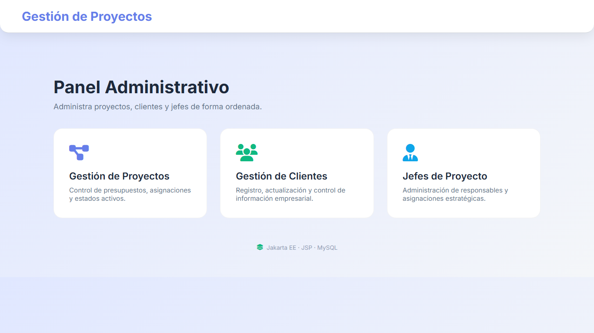 | 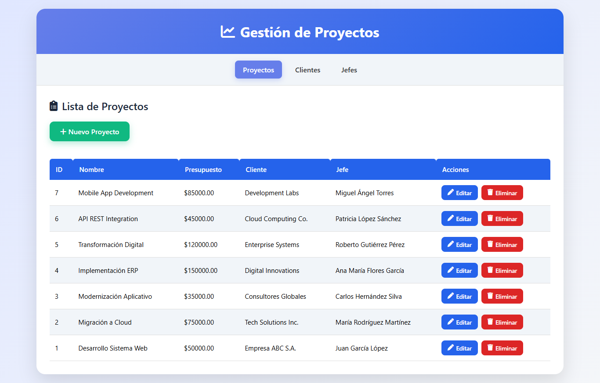 |

| Cliente creado, con mensaje de éxito y UTF-8 | Validación del presupuesto en el servidor |
|---|---|
| 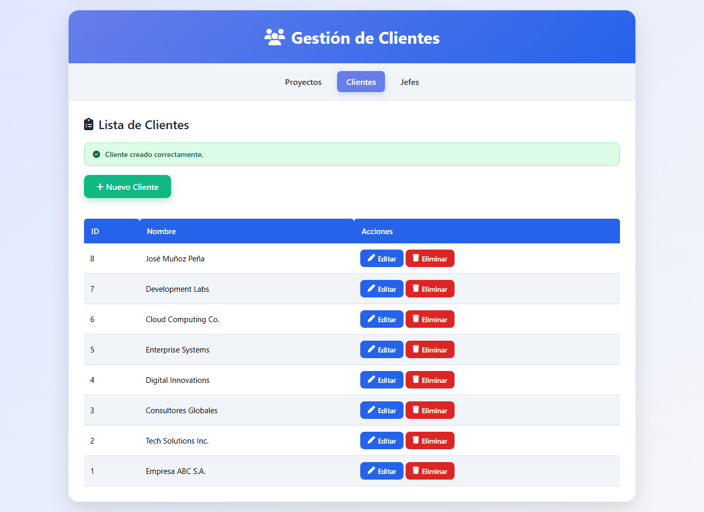 | 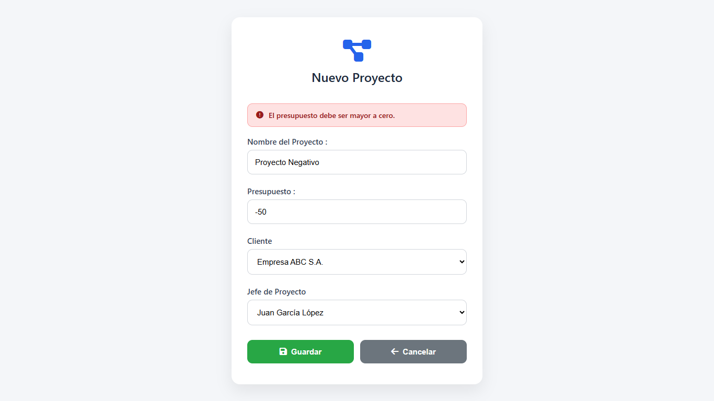 |

| Proyecto creado | Integridad referencial: no se elimina un cliente con proyectos |
|---|---|
| 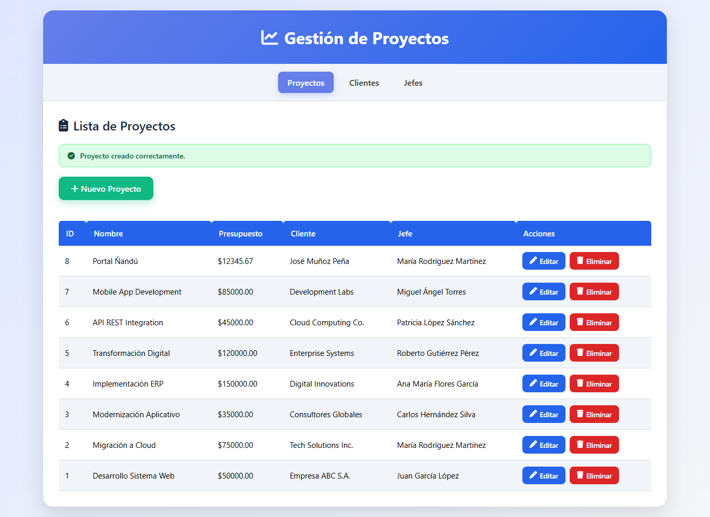 | 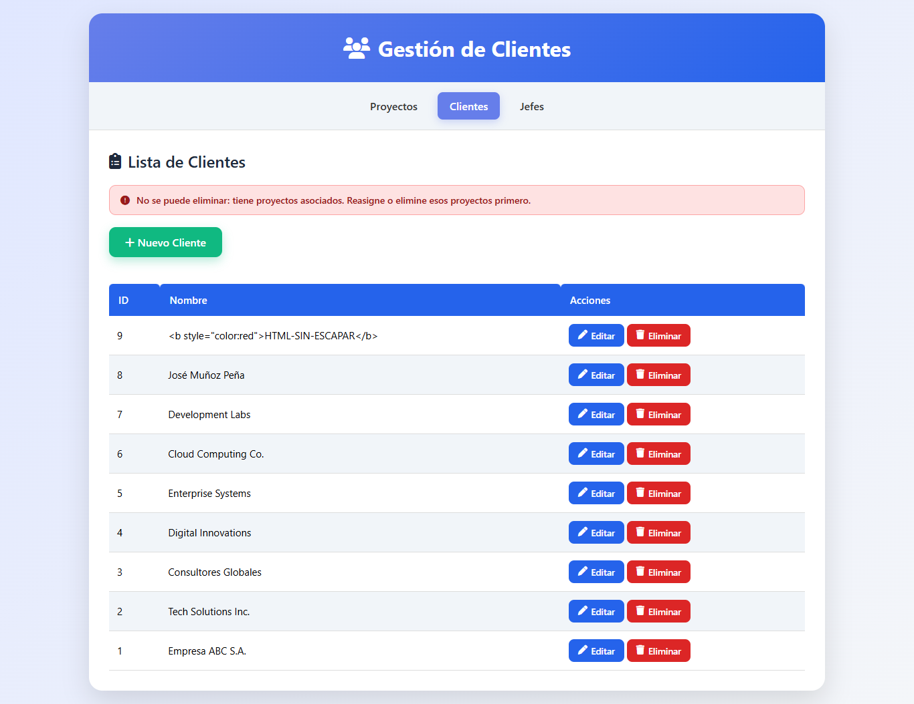 |

| HTML introducido por el usuario mostrado como texto (XSS neutralizado) | Vista móvil |
|---|---|
| 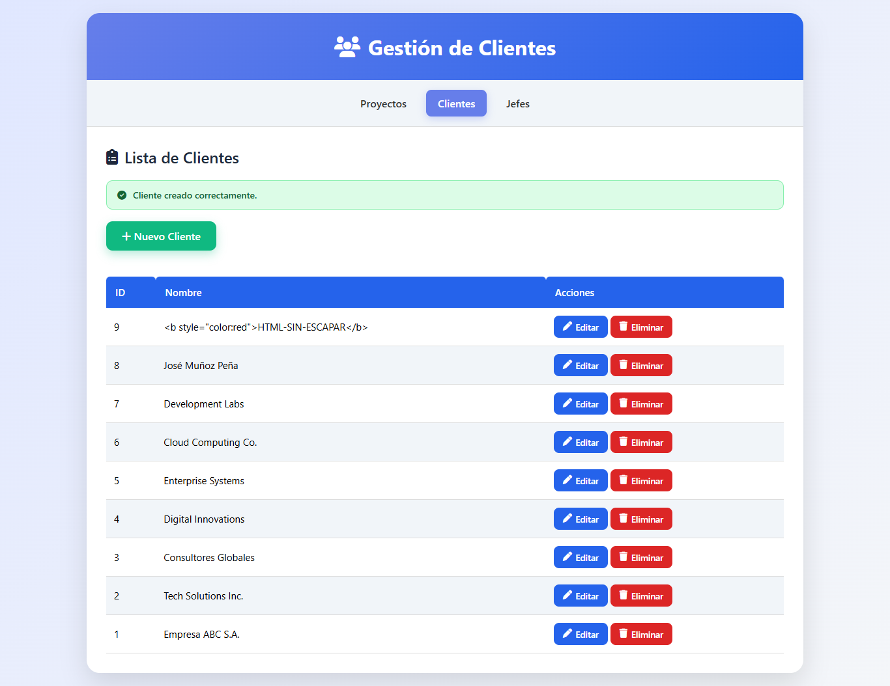 | 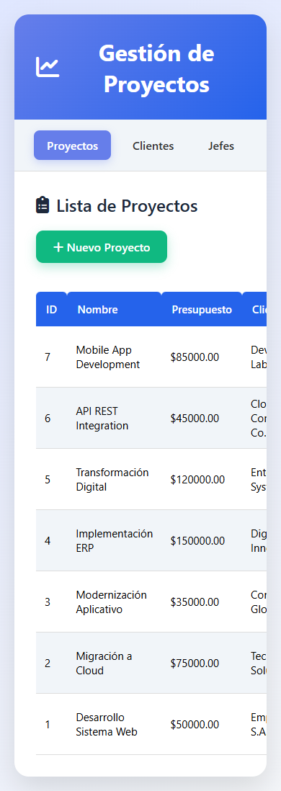 |

## Funcionalidades

| Funcionalidad | Cómo se usa | Resultado | Restricciones |
|---|---|---|---|
| CRUD de proyectos | Menú **Proyectos** → *Nuevo*, *Editar*, *Eliminar* | El listado muestra nombre, presupuesto, cliente y jefe | Cliente y jefe obligatorios |
| CRUD de clientes | Menú **Clientes** | Alta, edición y baja con mensaje de confirmación | Nombre único; no se elimina si tiene proyectos |
| CRUD de jefes de proyecto | Menú **Jefes** | Igual que clientes | Nombre único; no se elimina si tiene proyectos |
| Validación en el servidor | Al guardar cualquier formulario | Mensaje de error visible; el formulario conserva lo escrito | Presupuesto > 0, máximo 2 decimales y dentro del rango `DECIMAL(15,2)`; longitudes máximas |
| Mensajes de error de base de datos | Automático | Duplicados, integridad y falta de conexión se traducen a mensajes comprensibles | — |
| Eliminación segura | Botón **Eliminar** | Pide confirmación y envía un formulario POST | — |
| Interfaz adaptable | Cualquier pantalla | Diseño responsive | — |

**Fuera del alcance (no implementado):** autenticación de usuarios, roles, paginación y búsqueda.

## Tecnologías

| Categoría | Tecnología | Uso |
|---|---|---|
| Lenguaje | Java 17 | Lógica del servidor |
| Backend | Jakarta Servlet 6.0, JSP 3.0, JSTL 3.0 (Jakarta EE 10) | Controladores y vistas |
| Base de datos | MySQL 8 (compatible con MariaDB 10.4+), `mysql-connector-j` | Persistencia mediante JDBC |
| Servidor de aplicaciones | GlassFish 7 / Payara 6 | Despliegue del WAR |
| Construcción | Maven | Dependencias, compilación y empaquetado WAR |
| Pruebas | JUnit 5 | Validaciones y traducción de errores |
| Interfaz | HTML, CSS propio, Font Awesome (CDN) | Presentación |

## Arquitectura

```
gestion-proyectos-jakarta/
├── base_datos.sql                      Esquema y datos de ejemplo
├── pom.xml                             Dependencias y empaquetado WAR
├── src/main/java/com/espe/gestion/
│   ├── model/                          Cliente, JefeProyecto, Proyecto (POJOs)
│   ├── dao/                            ClienteDAO, JefeProyectoDAO, ProyectoDAO (JDBC + PreparedStatement)
│   ├── controller/                     Un servlet por entidad + ControladorBase + ValidacionException
│   └── utils/Db.java                   Conexión configurable por variables de entorno
├── src/main/webapp/
│   ├── index.jsp                       Panel principal
│   └── WEB-INF/                        Vistas JSP, fragmentos/alertas.jspf, web.xml
├── src/test/java/…/controller/         Pruebas JUnit 5
└── docs/screenshots/                   Capturas del README
```

**Flujo de una petición:**

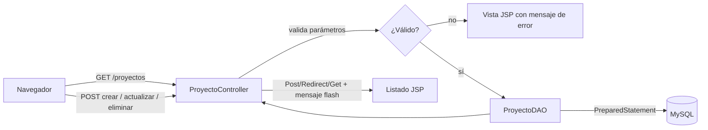

- **Controladores** (`/proyectos`, `/clientes`, `/jefes`): las lecturas usan GET; crear, actualizar y eliminar solo se aceptan por POST. Después de cada escritura se redirige al listado con un mensaje (patrón Post/Redirect/Get).
- **`ControladorBase`** centraliza la lectura de parámetros, los mensajes flash y la traducción de `SQLException` a mensajes para el usuario.
- **DAOs**: `try-with-resources` en todas las conexiones; el listado de proyectos carga cliente y jefe en una sola consulta con `JOIN`.

## Modelo de datos

**SGBD:** MySQL 8 / MariaDB, motor InnoDB, `utf8mb4`. El script `base_datos.sql` crea la base `gestion_proyectos` con 7 registros de ejemplo por tabla.

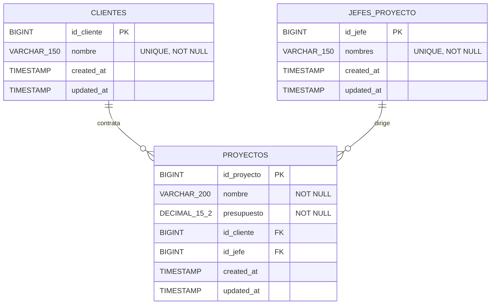

| Restricción | Efecto |
|---|---|
| `fk_proyecto_cliente`, `fk_proyecto_jefe` con `ON DELETE RESTRICT` | No se puede eliminar un cliente o un jefe que tenga proyectos; la aplicación lo informa |
| `ON UPDATE CASCADE` | Si cambia una clave primaria, se propaga a los proyectos |
| `UNIQUE` en `clientes.nombre` y `jefes_proyecto.nombres` | Evita duplicados; la aplicación muestra un mensaje claro |

## Seguridad

### Medidas implementadas y comprobadas

| Riesgo | Medida | Cómo se comprobó |
|---|---|---|
| Inyección SQL | Todas las consultas usan `PreparedStatement` | Revisión de los tres DAOs |
| XSS almacenado | Todo dato de usuario se escapa en las vistas (`<c:out>`, `fn:escapeXml`) | E2E: un nombre con `<script>` se muestra como texto (captura 7) |
| Escritura mediante GET (CSRF simple, borrados por enlaces) | Crear, actualizar y eliminar solo por POST | E2E: un GET de eliminación ya no borra |
| Credenciales en el código | `DB_URL`, `DB_USER` y `DB_PASSWORD` se leen del entorno | Revisión del código; el repositorio no contiene contraseñas |
| Filtración de detalles técnicos | El usuario ve mensajes claros; el detalle queda en el log del servidor | E2E |

### Riesgos conocidos y recomendaciones pendientes

- **No hay autenticación ni autorización:** cualquier persona con acceso a la URL puede modificar los datos. Es adecuado solo para una red local o una demostración.
- **No hay token CSRF:** limitar la escritura a POST reduce el riesgo, pero un sitio malicioso podría enviar un formulario POST. Se recomienda añadir un token por sesión.
- El usuario por defecto de la base de datos es `root` sin contraseña (valor de desarrollo). En cualquier otro entorno conviene crear un usuario con permisos mínimos y definir `DB_PASSWORD`.

## Instalación y ejecución local

**Requisitos previos:** JDK 17 o superior (las pruebas se ejecutaron con JDK 25), Maven 3.9+, MySQL 8 o MariaDB 10.4+, y GlassFish 7 o Payara 6.

```bash
# 1. Crear la base de datos con datos de ejemplo
mysql -u root -p < base_datos.sql

# 2. Compilar, ejecutar las pruebas y generar el WAR
mvn clean package

# 3. Desplegar en Payara / GlassFish
asadmin start-domain
asadmin deploy --contextroot gestion-proyectos target/gestion-proyectos.war
```

Abrir <http://localhost:8080/gestion-proyectos/>.

### Variables de configuración

| Variable | Valor por defecto |
|---|---|
| `DB_URL` | `jdbc:mysql://localhost:3306/gestion_proyectos?useSSL=false&allowPublicKeyRetrieval=true&serverTimezone=UTC&characterEncoding=UTF-8` |
| `DB_USER` | `root` |
| `DB_PASSWORD` | *(vacía)* |

Se pueden definir como variables de entorno del proceso del servidor o como propiedades de la JVM:

```bash
asadmin create-jvm-options "-DDB_USER=gestion"
asadmin create-jvm-options "-DDB_PASSWORD=<tu-clave>"
asadmin restart-domain
```

### Problemas frecuentes

| Síntoma | Causa probable |
|---|---|
| «No se pudo conectar con la base de datos» | MySQL no está iniciado, o `DB_URL`/`DB_USER`/`DB_PASSWORD` no coinciden |
| `Public Key Retrieval is not allowed` | Falta `allowPublicKeyRetrieval=true` en una `DB_URL` personalizada |
| Error 404 tras desplegar | El *context root* no es `gestion-proyectos` |

## Pruebas y validación

| Tipo | Qué se probó | Cómo | Resultado |
|---|---|---|---|
| Unitarias (JUnit 5) | Lectura de IDs, validación de textos, reglas del presupuesto y de los campos de un proyecto, traducción de códigos de error de MySQL | `mvn test` | ✅ **14/14** (2026-10-28, JDK 25) |
| Extremo a extremo (manual guiada en Chrome) | CRUD de las tres entidades, validaciones, integridad referencial, XSS, UTF-8, eliminación por POST, ID inválido, vista móvil | Payara 6 + MariaDB | ✅ **21/21** (2026-10-07) |

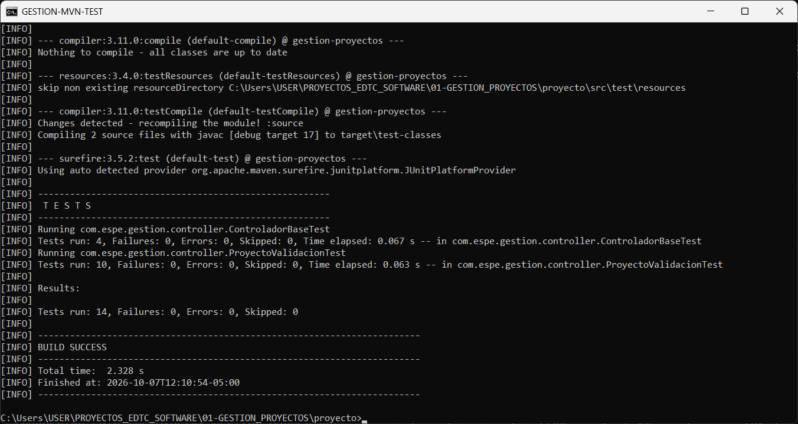

**No hay pruebas automatizadas de los DAOs ni de los servlets contra una base de datos real.** Esa parte se comprobó solo con la verificación E2E.

## Limitaciones y mejoras futuras

- Añadir autenticación, roles y tokens CSRF.
- Automatizar las pruebas de los DAOs (por ejemplo, con Testcontainers) y las E2E (Playwright o Selenium).
- Paginación y búsqueda en los listados.
- Pool de conexiones mediante un `DataSource` del servidor en lugar de `DriverManager`.

## Autoría y créditos

**Desarrollador: Edgar Damian Toscano Coro**
Estudiante de Ingeniería de Software
Universidad de las Fuerzas Armadas ESPE

Proyecto académico individual. En octubre de 2026 se corrigieron errores de seguridad y funcionamiento (XSS, borrado por GET, errores silenciosos) y se añadieron las pruebas, con asistencia de una herramienta de IA (Claude Code). Font Awesome se carga desde su CDN bajo su propia licencia.

Distribuido bajo la [licencia MIT](LICENSE).
